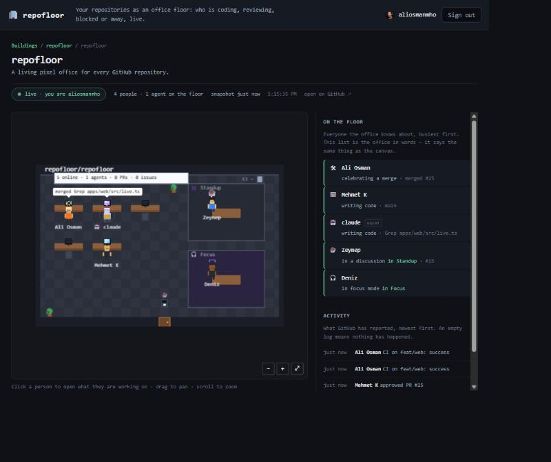

# apps/web

Full mode's UI: the buildings list, one building's offices, and the office page that
runs [`@repofloor/engine`](../../packages/engine) against a live snapshot.



Vite + TypeScript, no framework. Four pages do not need one, and `apps/web` is meant to
stay thin — the contract is `@repofloor/protocol`, the behaviour is in the packages.

```
/                    every building this viewer may see        (GET /offices)
/:owner              that building's offices                   (GET /offices, filtered)
/:owner/:repo        the office: canvas, status strip, log     (GET /office/:owner/:repo + socket)
/installed           where GitHub lands an owner after an install
```

## Running it

```bash
pnpm --filter @repofloor/web dev          # http://localhost:5174
```

The dev server proxies `/auth`, `/offices` and `/office` to `http://localhost:8787`
(override with `API_URL=…`), so run `apps/api` beside it. For working on the page alone,
there is a fixture that answers those routes and speaks the socket, with a seeded office
and a trickle of events:

```bash
pnpm --filter @repofloor/web dev:fake     # fake api on :8787, fake socket on :8788
```

`ANONYMOUS=1` makes it answer `/auth/me` with a 401, `PARTIAL=1` makes `GET /offices`
report a partial listing, and `TICK_MS` changes how often something happens. It
authorizes nothing: never run it anywhere but a laptop.

## Deployment: one origin

The api, the socket and these files are served from **one hostname**, behind one reverse
proxy. That is not a preference:

- The session cookie is `HttpOnly` and `SameSite=Lax`, so a cross-site `fetch` would not
  carry it, and `apps/api` sends no CORS headers. A browser's only identity is that
  cookie ([ADR 0002](../../docs/adr/0002-realtime-transport.md)), so the page has to be
  same-site with the api or it is permanently signed out.
- `apps/api` and `apps/realtime` both answer on `/office/:owner/:repo`. The proxy routes
  that path by the `Upgrade` header: a WebSocket upgrade to realtime, a plain `GET` to
  the api.

Everything else — `/`, `/:owner`, `/:owner/:repo`, `/installed`, `/assets/*` — is this
bundle, with the usual SPA fallback to `index.html` for unknown paths.

```
  /webhook /offices /office/** (GET)   ──▶ apps/api        :8787
  /auth/**                             ──▶ apps/api        :8787
  /office/** (Upgrade: websocket)      ──▶ apps/realtime   :8788
  everything else                      ──▶ apps/web/dist   (static, index.html fallback)
```

[`Caddyfile`](Caddyfile) is that table, and [`Dockerfile`](Dockerfile) builds the bundle
and bakes it into a Caddy image that is both the static server and the edge proxy. It is
the `web` service in the root `docker-compose.yml`, so `docker compose up --build` gives
you the whole thing on <http://localhost:8080>.

One warning from having got it wrong: **Caddy matches header values case-sensitively**,
while RFC 9110 makes them case-insensitive. The matcher is `header Connection *pgrade*`,
not the documented `*Upgrade*`, because browsers send `connection: upgrade` in lower
case. Wrong, the upgrade lands on `apps/api`, which answers an ordinary `404`, and the
page shows a floor that never moves with nothing in any log to say why. `pnpm smoke`
checks it.

Two build-time escapes exist for other arrangements: `VITE_API_BASE` (a path prefix or
another origin, which then needs CORS of its own) and `VITE_REALTIME_URL` (an absolute
`ws(s)://` or `http(s)://` address). Both are empty in the deployment above. In
development `VITE_REALTIME_URL` defaults to `ws://localhost:8788`, because the socket
cannot be proxied on a path the api also answers.

Point the App's **Setup URL** at `/auth/install/callback?return_to=/installed` to get the
install landing page instead of its JSON.

## What it does not do

- **It decides nothing about access.** It renders what the api answers. A `401` offers
  sign-in; a `404` says the office does not exist *or* is not readable by this account,
  because the api refuses to distinguish them and so must this page (CLAUDE.md rule 6).
- **It does not reach around the engine.** `OfficeState` goes to `setState`,
  `OfficeEvent` to `applyEffect`, and nothing else crosses (rule 1). The same renderer
  draws the Lite page from a static file.
- **It keeps no credential.** The GitHub token lives in the api's memory; this page never
  sees one.

## Layout

```
src/
  main.ts         the shell: /auth/me, the header, the router
  router.ts       history routing, link interception
  route.ts        pathname → route (pure)
  api.ts          the api as this page sees it, with a small failure vocabulary
  live.ts         the socket: connect, hello/snapshot/events, backoff, give up on a refusal
  wire.ts         the client's view of apps/realtime's frames, validated (pure)
  describe.ts     state and events as words: the strip and the log (pure)
  endpoints.ts    url building (pure)
  backoff.ts      reconnect delays with jitter (pure)
  views/          one file per page, plus the shared loading/empty/error states
scripts/
  fake-services.mjs   the fixture above
```

The pure modules are the tested ones (`pnpm --filter @repofloor/web test`, 45 tests, no
DOM): routing, url building, frame parsing, the strip and log wording, the api's failure
mapping, and the socket's state machine against a fake socket.
