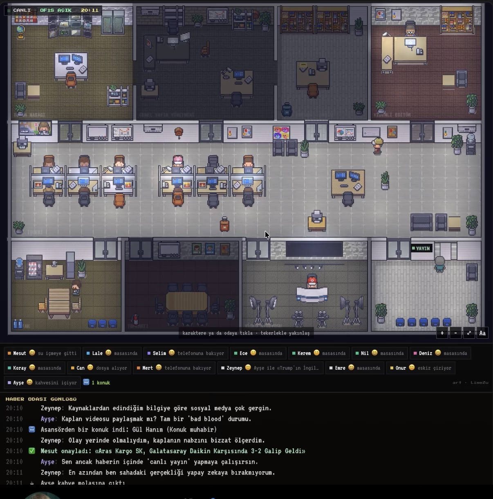

# Visual target

Reference supplied by @aliosmanmho on 2026-10-15 (a pixel-art newsroom sim). This is
the **look and the information density** we want — not a spec to copy, and not an art
style to license. Recording it here so that engine work has something concrete to aim
at instead of "nicer".

Today's office (`docs/assets/office.png`) is one open floor with desks on a grid. The
reference is a *building interior*. That gap is the work.

## What it gets right, in rough order of value

1. **Rooms are architecture, not labelled regions.** Interior walls, doorways, glass
   partitions, a corridor between blocks. Our `Room` already exists in the protocol
   (`kind: floor | team | meeting | focus`) but renders as a tinted area; here a room
   is a space you can see into and walk between. This is the single biggest difference.
2. **Furniture variety carries meaning.** Desks differ by role, a meeting room has a
   table and chairs, the studio has cameras, the lobby has a sofa and an elevator. Our
   desks are identical. Procedural still, but parameterised by room kind — rule 5 holds,
   no asset pipeline required.
3. **Per-actor status chips under the canvas.** A strip of `name · emoji · what they
   are doing` ("masasında", "telefonuna bakıyor", "kahvesini içiyor"). We have this
   information in `ActorState.status` + `detail` and currently only show it on hover.
   Promoting it to a permanent strip makes the office readable without the canvas at
   all — which is most of issue #15 (the accessibility text alternative) for free.
4. **A running activity log.** Timestamped lines of what just happened. Ours is the
   event stream; nothing renders it. Cheap to add and it makes the page legible on a
   phone, where the canvas is small.
5. **A status bar**: live indicator, "office open", a clock.
6. **Interaction affordances spelled out on the canvas** ("click a character or a room ·
   zoom with the wheel"). We have pan and zoom already and tell nobody.
7. **Muted palette, high contrast on people.** Furniture is desaturated; avatars carry
   the colour. That is why a crowded floor stays readable.

## What we deliberately do not take

- **Simulated chatter.** The reference is a sim: its characters invent dialogue. Ours
  show what GitHub actually reports. An empty office means nobody pushed, and it should
  look empty.
- **Per-person duration.** The reference tracks people over time. We do not, and will
  not — not a surveillance tool.
- **Named rooms from fiction** (studio, broadcast desk). Our rooms come from GitHub
  Teams and PR huddles.

## Where this lands

Not scheduled yet. Phase 2 (Full mode: `apps/api`, `apps/realtime`, `apps/web`) stays
ahead of it — a prettier floor with nothing live on it is worth less than a plain floor
that updates in a second.

Candidates when it is time, cheapest first:

- ~~the status-chip strip and the activity log (no engine change, and #15 falls out)~~ —
  done in `apps/web` with Phase 2C (`src/describe.ts` is pure and DOM-free, so the Lite
  page in `apps/demo` can lift it as it is). Items 5 and 6 came with it: the office page
  has a status bar with a live indicator and a clock, and it finally tells people that
  they can click a person, drag to pan and scroll to zoom
- room walls and doorways in `computeLayout`
- furniture parameterised by room kind
- palette pass

The `good first issue` set (#1-#16) stays as it is; these are larger than those and
belong in a Phase 1.5 of their own.
